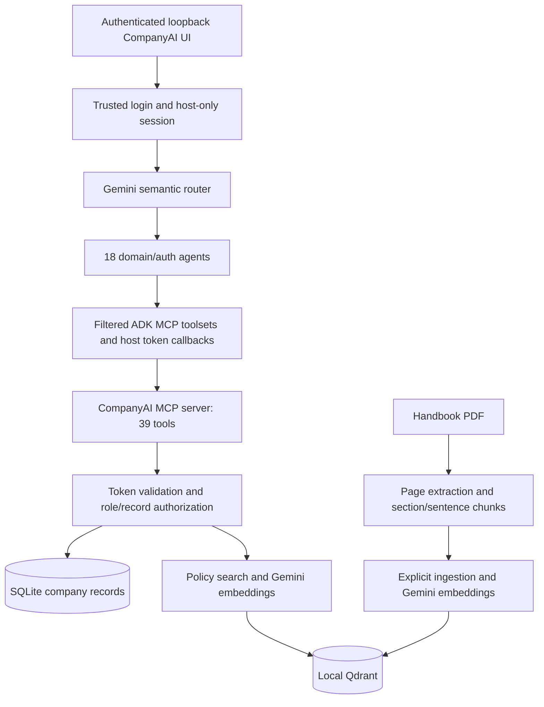

# CompanyAI architecture

CompanyAI is a local Google ADK application. Its import/application directory is
`company_system`; the root is `company_ai_supervisor`. Those identifiers remain
stable for existing clients. The project brand is CompanyAI.

The router asks Gemini for a Pydantic `RoutingDecision`. Confidence gating,
second-pass classification and the configured Gemini fallback are retained.
It invokes one selected specialist; it is not a keyword dispatcher. Unknown or
low-confidence requests receive a clarification. The route never grants access.

Each specialist has its existing instructions and domain tool allowlist. The
instruction provider supplies the current date and non-secret session identity
so self-service requests can use the authenticated employee ID. A transport-only
MCP wrapper supplies the host-held token without modifying model-call events. The MCP server hashes
tokens in SQLite and rechecks the authoritative account on every protected call.

SQLite stores company and authentication data. Qdrant stores only handbook
vectors and source/page/text payloads. Gemini generation, routing and embeddings
use the configured `.env` variables; the evaluator model is configured separately.

STDIO is the agent integration transport. A loopback streamable HTTP server is
also available for independent MCP clients. There are no application-defined
MCP resources or prompts, no hosted deployment, and no separate authenticated
REST CRUD business API. Stock ADK web is an unauthenticated development interface
and is not mounted by the supported authenticated local launcher.

See [agents](AGENTS.md), [MCP](MCP_GUIDE.md), [data](DATABASE_GUIDE.md),
[RAG](RAG_GUIDE.md), and [security](SECURITY.md) for operational details.

## 2026-11-04 credential boundary update

The supported entry point is now the authenticated loopback interface in
`company_system/local_web.py`, launched by `start_project.ps1`. It uses the existing
ADK Runner/supervisor and all 18 agents. Login and HR credential administration
run in trusted host code before conversation creation, with a separate HTTP form.
Bearer tokens live only in host memory/context, not ADK session state or model
arguments. The model-facing tool wrapper injects tokens only at the MCP transport
boundary and removes secret response fields. Login/create/update/delete credential
tools are withheld from models; all 39 MCP wire schemas remain available unchanged
to trusted clients. Stock ADK development/debug/session APIs are not mounted.
See `docs/SECURITY.md` (or `SECURITY.md` from this directory) for boundaries and limits.
